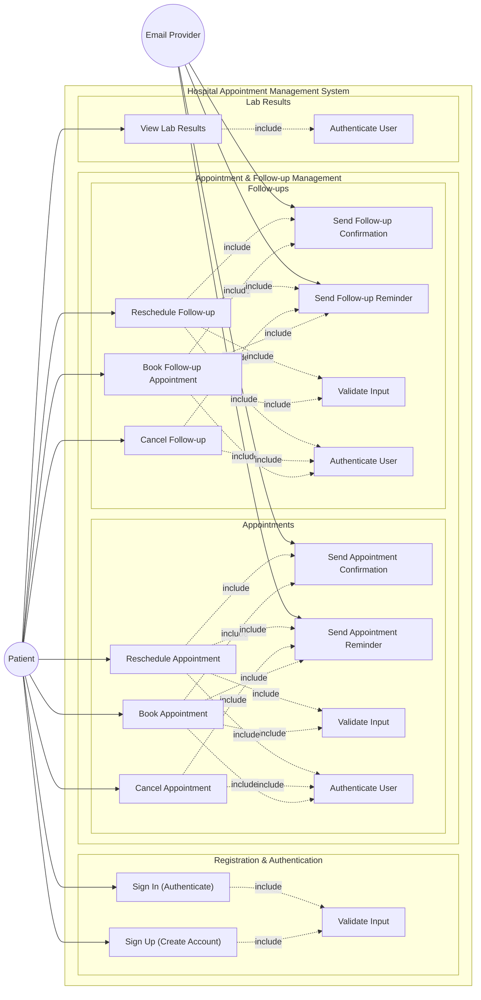
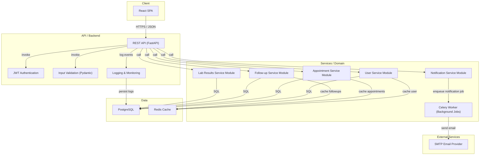
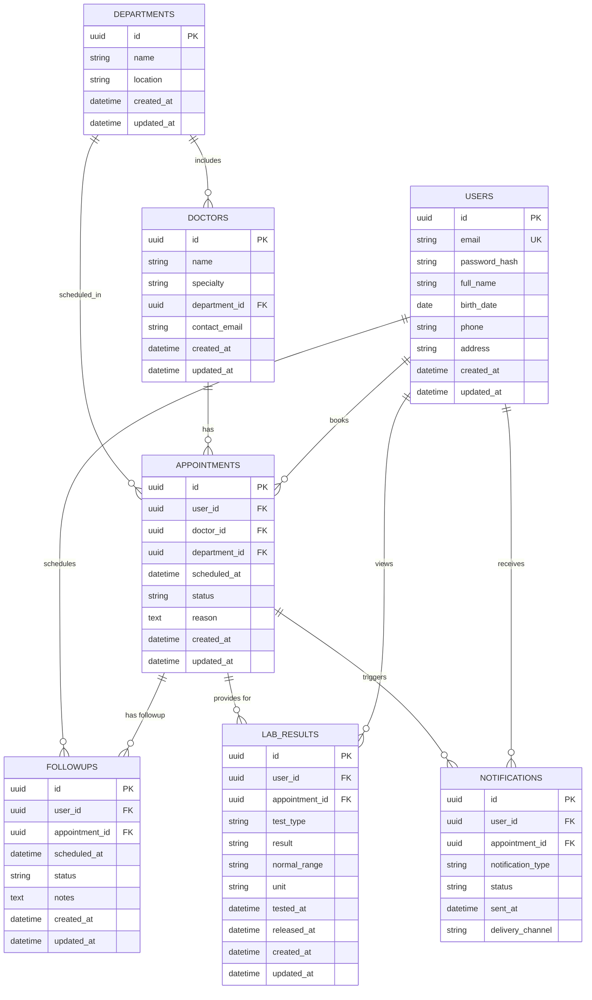
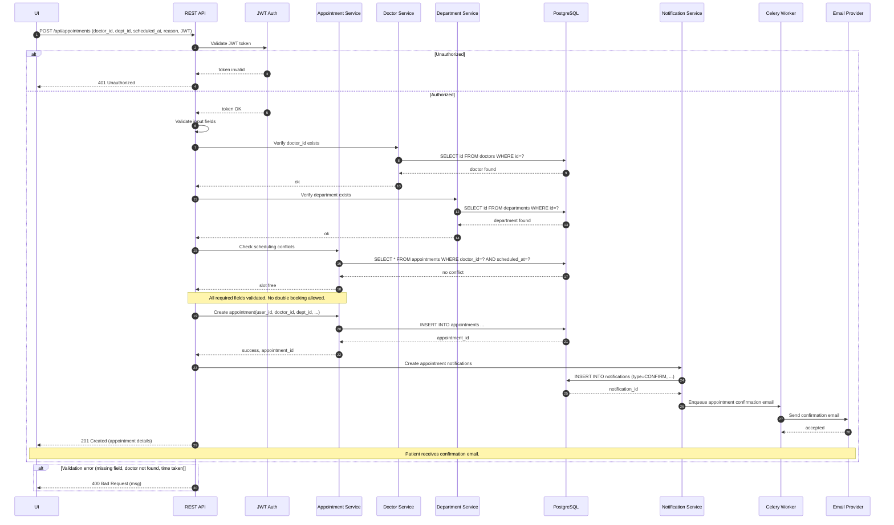

# Hospital Appointment Management Application

> Manage your healthcare appointments effortlessly.

A low-fidelity prototype of **Hospital Appointment Management Application**, generated by an agentic AI project manager from a stakeholder conversation in Slack.

## Screens

- [Landing Page](index.html) — View the main features of the application.
- [Sign Up](signup.html) — Create a new account to access the application.
- [Sign In](signin.html) — Log into an existing account.
- [Book Appointment](book_appointment.html) — Schedule an appointment with the hospital.
- [Manage Follow-ups](manage_followups.html) — Schedule and manage follow-up appointments.
- [View Lab Results](view_lab_results.html) — Review lab test results online.

## What this prototype fakes

- The prototype does not include user authentication functionality.
- All forms and interactions on each page are not functional.
- The content is filled with placeholder information to represent realistic scenarios.

## System design

### Hospital Appointment Management System: Use Case Diagram

This use case diagram details all the primary interactions among system actors (Patient, Email Provider), capturing the full range of functional requirements. Patients can perform core tasks such as signing up, logging in, booking and managing both appointments and follow-ups, as well as viewing lab results. Input validation and authentication are systematically applied to all sensitive use cases, illustrated as included dependencies, ensuring correct usage flows. Sending confirmation and reminder notifications is split into distinct supporting use cases, tied to appointment and follow-up flows. The system boundary is neatly organized into Registration & Authentication, Appointment & Follow-up Management, and Lab Results function areas, with explicit relationships to both internal and external (email notification) actors. This explicit structure reflects real domain requirements and clearly traces every action to its supporting system processes.

### Layered System Architecture with Concrete Technologies

This architecture diagram provides a precise breakdown of the application's technical layers and concrete components. The client is a React SPA; all user actions are routed via HTTPS/JSON to a FastAPI-powered REST API. The backend layers include dedicated modules for User Management, Appointment, Follow-up, and Lab Results domain logic, plus a Notification module orchestrating asynchronous email flows. PostgreSQL serves as the system of record for all persistent business entities, augmented by Redis for high-speed access and session management. Celery workers handle background tasks (appointment/follow-up reminders, confirmations) and interface with an SMTP-compatible Email Provider. Centralized logging and monitoring capture operational metrics and error conditions. Every component interaction and message flow is labelled, clarifying the precise integration pathways and governance of cross-cutting concerns such as authentication, validation, and notification.

### Database Entity Relationship Diagram

This detailed Entity Relationship Diagram enumerates all persistent entities necessary to fulfill the core and supporting features. USERS table models patient registration, authentication, and profile. DOCTORS represents medical staff to allow selection for appointments. DEPARTMENTS normalizes hospital departments. APPOINTMENTS links a user, doctor, and department with scheduling attributes. FOLLOWUPS references both USERS and parent APPOINTMENTS, providing traceability for ongoing care. LAB_RESULTS links users and appointments with result metadata and outcome details. NOTIFICATIONS logs notification events for auditing. DISTINCT join relationships and cardinality express business rules clearly: a user can have many appointments and followups, every appointment references a doctor and department, and lab results anchor to both a user and their appointment. Every entity is annotated with all key, foreign key, and business attributes needed for both domain logic and auditing.

### Book Appointment End-to-End Sequence

This sequence diagram traces a patient’s journey to book a hospital appointment from the UI across all relevant technical layers. After submitting a booking request, the API verifies the JWT token, then validates input via domain and scheduling business rules (like department and doctor existence, date/time clashes). Upon successful checks, the Appointment Service creates the new appointment record in PostgreSQL. A confirmation and reminder notification job is enqueued via the background Celery worker, which in turn sends emails through the SMTP provider. Branches handle validation errors, authentication failures, and unsuccessful attempts to book in a full time slot. System notes flag where data validation and scheduling rules apply, ensuring that true domain constraints are enforced across every layer and decision point.

## Running it

Every file is static. Open `index.html`, or serve the directory with any static file server.
